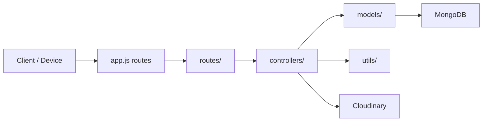

# Green Sync Backend

This folder contains the Node.js backend for Green Sync. It provides Express API routes for owners, caretakers, plants, sensor readings, authentication, uploads, and data persistence.

## Contents

```text
Backend/
+-- app.js
+-- index.js
+-- package.json
+-- docker-compose.yml
+-- checks/
+-- config/
+-- controllers/
+-- middleware/
+-- models/
+-- routes/
+-- utils/
+-- public/
+-- temp/
+-- mongo/
```

## Application Flow



## Setup

Install dependencies:

```bash
npm install
```

Start the backend:

```bash
npm start
```

Run development mode:

```bash
npm run dev
```

Stop configured development containers:

```bash
npm run stop
```

## Key Files

- `app.js` configures Express middleware and mounts API routes.
- `index.js` connects to the database and starts the server.
- `package.json` defines dependencies and npm scripts.
- `docker-compose.yml` defines the local MongoDB replica set.
- `endpoints` can be used to track API endpoint notes.
- `errorCodes.csv` can be used to document application-level error codes.
