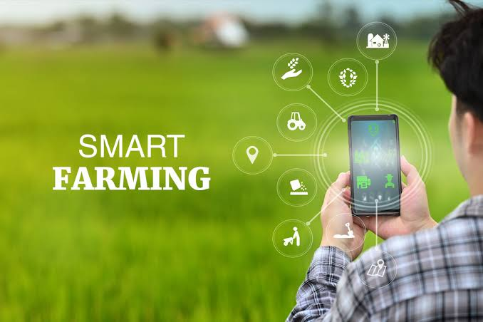
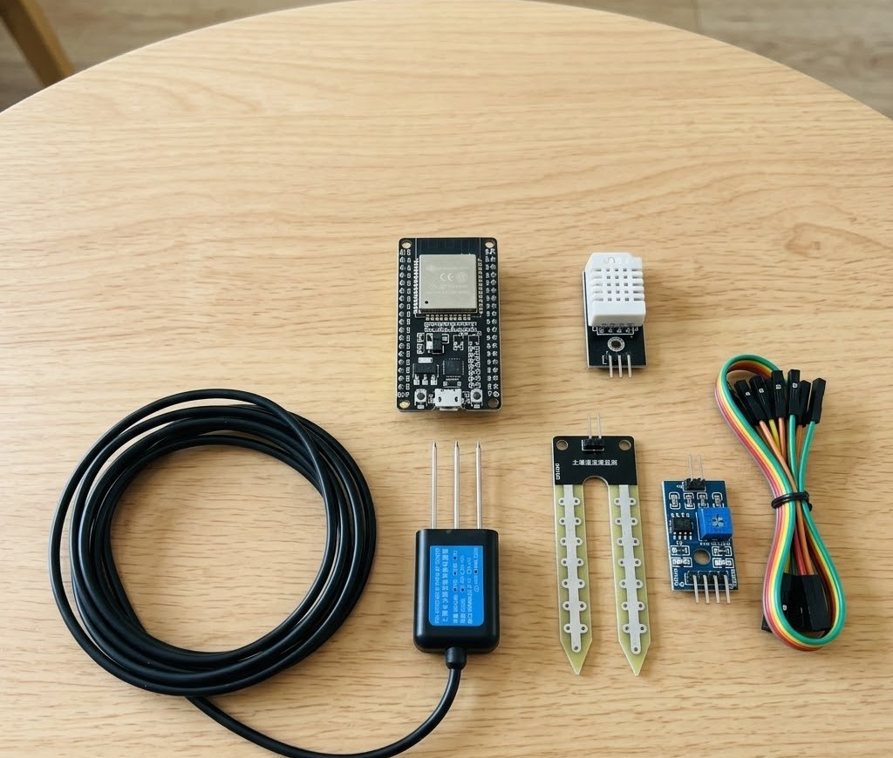
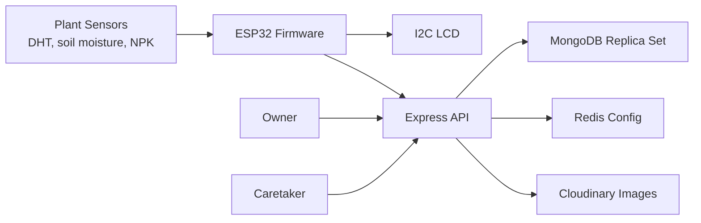

# Green Sync



Green Sync is a capstone project for a smart plant monitoring and care system. It combines ESP32-based sensor hardware, KiCad electronics design, and a Node.js backend that manages owners, **CARETAKERS**, plants, and plant sensor readings.

The project is built as a complete hardware-plus-software prototype for tracking plant health metrics such as soil moisture, temperature, humidity, and NPK nutrient values.

## Table of Contents

- [Overview](#overview)
- [Features](#features)
- [Architecture](#architecture)
- [Tech Stack](#tech-stack)
- [Backend Setup](#backend-setup)
- [Environment Variables](#environment-variables)
- [API Overview](#api-overview)
- [Electronics and Firmware](#electronics-and-firmware)
- [Future Scope](#future-scope)

## Overview

Green Sync focuses on making plant care more measurable and automated. The hardware layer reads plant and environment data, while the backend stores user, plant, caretaker, and reading data for a future web or mobile dashboard.



The repository currently includes:

- Express.js backend APIs for owners, caretakers, plants, and readings.
- MongoDB/Mongoose models for application data.
- Docker Compose setup for a five-node MongoDB replica set.
- ESP32 firmware for WiFi-based plant telemetry.
- KiCad PCB and schematic files.
- Draw.io architecture/design files.
- Capstone proposal, midterm, and final report documents.
- CAD part files for the physical prototype.

## Features

- Owner registration, login, update, logout, deletion, and password/profile management.
- Caretaker creation and plant sharing workflow support.
- Plant creation and deletion with image upload support.
- Sensor reading ingestion endpoint for plant telemetry.
- JWT-protected routes for authenticated actions.
- Cloudinary integration for image storage.
- Multer-based multipart file upload handling.
- Redis configuration support.
- MongoDB replica set for local database development.
- ESP32 firmware for DHT, soil moisture, relay, LCD, and NPK sensor integration.

## Architecture



The ESP32 gathers sensor data and can send readings to a database/API endpoint. The backend handles application records such as owners, caretakers, plants, co-owners, notifications, fertilizers, and readings.

## Tech Stack

### Backend

- Node.js
- Express.js
- MongoDB
- Mongoose
- Docker Compose
- JWT
- Bcrypt
- Multer
- Cloudinary
- ioredis
- Cookie Parser
- CORS

### Hardware and Firmware

- ESP32
- Arduino/C++
- DHT temperature and humidity sensor
- Soil moisture sensor
- NPK sensor over serial/Modbus-style commands
- Relay module
- I2C LCD display
- KiCad PCB/schematic design


## Backend Setup

Backend source code is located at:

```text
Website/Backend/Backend
```

### Prerequisites

- Node.js 18 or newer
- npm
- Docker Desktop
- MongoDB tools if you want to inspect the local database manually

### Install Dependencies

```bash
cd Website/Backend/Backend
npm install
```

The current npm scripts expect Docker containers named `mongo` and `green-sync` for development:

```bash
npm run dev
```

If those containers do not already exist, start the database with Docker Compose first or update the script to match your local container names.

### Start the Backend

```bash
npm start
```

## Environment Variables

Create a `.env` file inside:

```text
Website/Backend/Backend
```

Recommended variables:

```env
PORT=8000
CHUGH_CORS_ORIGIN

MONGODB_URI=mongodb://localhost:27017/green-sync?replicaSet=rs0
MONGO_ROOT=./mongo-data

ACCESS_TOKEN_SECRET=replace_with_access_secret
ACCESS_TOKEN_EXPIRY=15m
REFRESH_TOKEN_SECRET=replace_with_refresh_secret
REFRESH_TOKEN_EXPIRY=10d

CLOUDINARY_CLOUD_NAME=replace_with_cloud_name
CLOUDINARY_API_KEY=replace_with_api_key
CLOUDINARY_API_SECRET=replace_with_api_secret

REDIS_HOST=
REDIS_PORT=
```

## API Overview

Base API path:

```text
/api/v1
```

### Owner Routes

| Method | Endpoint | Auth | Description |
| --- | --- | --- | --- |
| `PUT` | `/owner/create` | No | Register an owner with optional `profile_pic`. |
| `POST` | `/owner/login` | No | Login an owner. |
| `POST` | `/owner/update` | Yes | Update owner details. |
| `DELETE` | `/owner/delete` | Yes | Delete owner account. |
| `POST` | `/owner/changePwd` | Yes | Change owner password. |
| `POST` | `/owner/changeProfilePicture` | Yes | Update owner profile image. |
| `POST` | `/owner/logout` | Yes | Logout owner. |
| `GET` | `/owner/getAccess` | No | Get access token flow. |
| `POST` | `/owner/addCaretaker` | Yes | Add a caretaker to a plant/account flow. |
| `GET` | `/owner/myPlants` | Yes | Fetch plants linked to the owner. |
| `GET` | `/owner/sharePlant` | Yes | Share a plant with a co-owner. |
| `DELETE` | `/owner/leavePlant` | Yes | Leave a shared plant. |
| `DELETE` | `/owner/removeCaretaker` | Yes | Remove caretaker access. |

### Plant Routes

| Method | Endpoint | Auth | Description |
| --- | --- | --- | --- |
| `POST` | `/plant/create` | Yes | Create a plant with optional `plant_pic`. |
| `DELETE` | `/plant/delete` | Yes | Delete a plant. |
| `POST` | `/plant/readings` | No | Submit sensor readings. |

### Caretaker Routes

| Method | Endpoint | Auth | Description |
| --- | --- | --- | --- |
| `PUT` | `/caretaker/create` | No | Register a caretaker with optional `profile_pic`. |

## Electronics and Firmware

The main firmware sketch is located at:

```text
Electronics/Green_sync.ino/Green_sync.ino.ino
```

The ESP32 firmware currently:

- Connects to WiFi.
- Reads humidity and temperature using a DHT sensor.
- Reads soil moisture through analog input pins.
- Reads nitrogen, phosphorus, and potassium values from an NPK sensor.
- Displays live readings on a 16x2 I2C LCD.
- Sends plant readings to a remote MongoDB Data API endpoint.
- Supports multiple plants through a linked-list structure.
- Controls relay pins for plant-side hardware.

Before uploading firmware, replace placeholders such as:

```cpp
YOUR_WIFI_SSID
YOUR_WIFI_PASSWORD
```

## Future Scope

- Build a frontend dashboard for owners and caretakers.
- Add live charts for temperature, humidity, soil moisture, and NPK trends.
- Add automated backend tests for auth, plant, and readings flows.
- Add deployment instructions for the backend, MongoDB, Redis, and media storage.